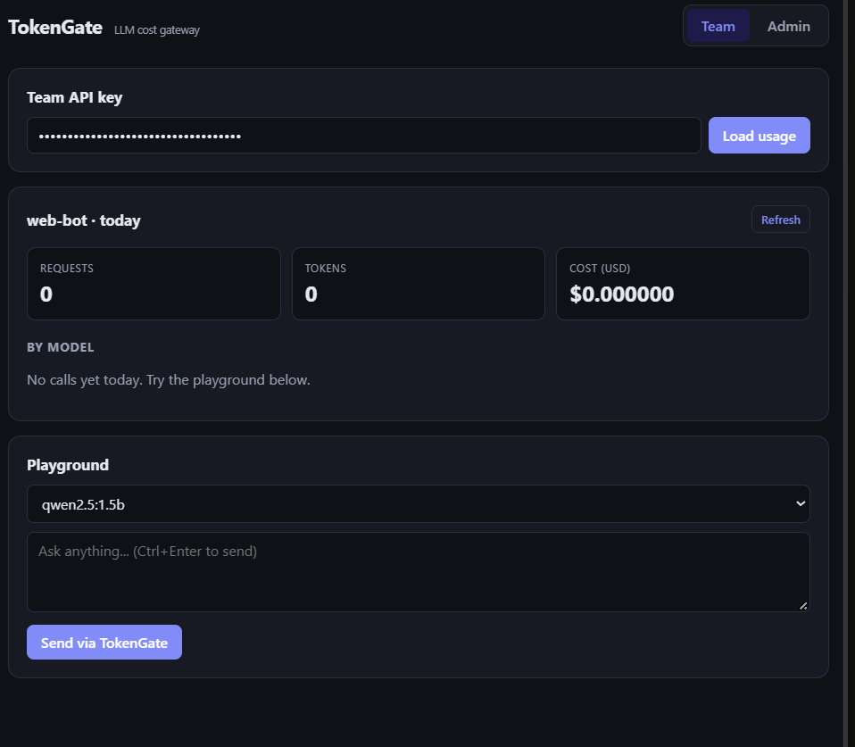
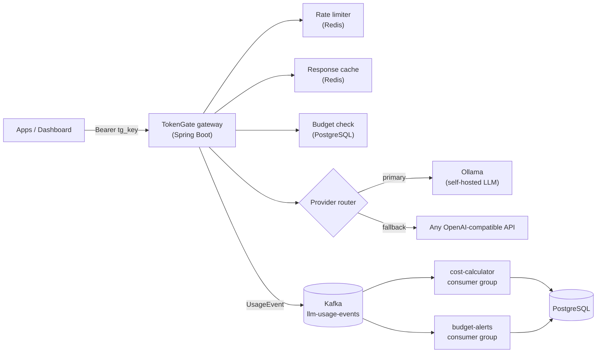

# TokenGate


**An LLM API gateway that tracks, controls and cuts AI costs per team.**

Built with Spring Boot, Kafka, Redis, PostgreSQL and React.



## The problem

Teams that ship AI features call providers like OpenAI or Claude from many places in their code. At the end of the month they get one big bill and no answers:

- Which feature or team spent the money?
- Did a buggy loop or a single user burn thousands of calls?
- Why did we not see this coming?

TokenGate sits between your apps and the AI providers. Every call goes through it, so every call is authenticated, limited, cached, budgeted and measured.

## Architecture



### Request flow

1. **Auth**: API key is hashed (SHA-256) and looked up. Raw keys are never stored.
2. **Rate limit**: per-team fixed window in Redis. Over the limit returns `429` with `Retry-After`.
3. **Cache**: identical prompt from the same team is served from Redis. Provider is skipped and the cost is $0.
4. **Budget**: if today's spend has reached the team's daily budget, the request is rejected with `429` before any provider call.
5. **Routing and fallback**: the router picks providers that support the model, in priority order. If the primary fails, the next one serves the request.
6. **Usage event**: a `UsageEvent` is published to Kafka asynchronously, so the response is never slowed down.
7. **Consumers**: two independent consumer groups read the same events. One computes cost and stores it; the other raises 80% and 100% budget alerts.

## Features

| Feature | How |
|---|---|
| OpenAI-compatible gateway | `POST /v1/chat/completions`, apps only change base URL and key |
| Per-team API keys | Generated once, stored as SHA-256 hash |
| Rate limiting | Redis `INCR` + TTL, per team per minute |
| Response caching | Redis, key = team + SHA-256 of request, 10 min TTL |
| Daily budgets | Enforced before provider call, `429` when exceeded |
| Budget alerts | Separate Kafka consumer group, one alert per threshold per day |
| Cost analytics | Kafka consumer computes cost per model with `BigDecimal` |
| Multi-provider fallback | Ordered providers, connect timeout, automatic failover |
| Streaming (SSE) | `"stream": true` returns OpenAI-style `chat.completion.chunk` events, passed through from the provider; usage and cache still recorded |
| Streaming (SSE) | `"stream": true` returns OpenAI-style `chat.completion.chunk` events, passed through from the provider; usage and cache still recorded |
| Dashboard | React: usage stats, model breakdown, playground, team admin, alerts |
| API docs | Swagger UI at `/swagger-ui.html` |

## Results

| Scenario | Result |
|---|---|
| Repeated prompt (Ollama, local CPU) | **~6,000 ms to ~30 ms** with cache hit, $0 provider cost |
| Streaming, warm local model | **First token in ~280 ms** instead of waiting ~6 s for the full answer |
| Primary provider down | Request still served by fallback provider, no error to client |
| Team over daily budget | Blocked with `429` before the provider is called |
| 13 requests in one minute (limit 10) | Requests 11 to 13 return `429` with `Retry-After` |

## Design decisions

- **Spring Security, stateless**: a custom filter only authenticates (team key or admin token); authorization rules live in one `SecurityFilterChain` (`/admin/**` needs ADMIN, `/v1/**` needs TEAM). Missing credentials return 401, wrong role returns 403. Admin token is compared in constant time.
- **Hashed API keys**: a database leak does not leak usable keys. Keys are shown only once at creation.
- **Async usage events**: cost tracking never adds latency to the user's request.
- **Idempotent consumer**: Kafka can redeliver events, so each event has a unique `eventId` and duplicates are skipped (also enforced by a unique DB constraint).
- **Partition key = team id**: all events of a team stay ordered in one partition.
- **Race-safe alerts**: the alert consumer sums stored costs *excluding* the current event and adds the current event's cost, so it is correct whether or not the cost consumer has already processed it.
- **Tenant-isolated cache**: team id is part of the cache key, so one team can never receive another team's cached answer.
- **Fail-open on Redis errors**: if Redis is down, rate limiting and caching are skipped with a warning instead of taking the gateway down.
- **No caching of degraded responses**: fallback responses are not cached, so the system recovers fully once the primary provider is back. (Found during testing.)
- **Streaming fallback only before the first byte**: if the primary provider fails before sending anything, the stream falls back to the next provider. Once chunks have reached the client, switching would mix two answers, so the stream ends with an error event instead.
- **Streaming fallback only before the first byte**: if the primary provider fails before sending anything, the stream falls back to the next provider. Once chunks have reached the client, switching would mix two answers, so the stream ends with an error event instead.
- **Known trade-off**: budgets are eventually consistent. Under heavy parallel load a team can slightly overshoot its budget, because cost is computed asynchronously. This keeps every request fast.

## Tech stack

**Backend:** Java 21, Spring Boot 4, Spring Data JPA, Spring for Apache Kafka, Spring Data Redis, springdoc-openapi
**Infra:** PostgreSQL 16, Apache Kafka (KRaft), Redis 7, Docker Compose, Ollama
**Frontend:** React, Vite
**Testing:** JUnit 5, AssertJ, Mockito

## Running locally

**Prerequisites:** Java 21, Docker Desktop, Node.js 20+, Ollama (optional, for real AI responses)

```bash
# 1. Infrastructure
docker compose up -d

# 2. Optional: a small local model
ollama pull qwen2.5:1.5b

# 3. Backend (http://localhost:8080)
./mvnw spring-boot:run

# 4. Dashboard (http://localhost:5173)
cd dashboard
npm install
npm run dev
```

Swagger UI: http://localhost:8080/swagger-ui.html

The default admin token is `dev-admin-secret` (local development only). Override it with the `TOKENGATE_ADMINTOKEN` environment variable.

## API quick reference

| Method | Path | Auth | Purpose |
|---|---|---|---|
| POST | `/admin/teams` | `X-Admin-Token` | Create a team, returns its API key once |
| GET | `/admin/teams` | `X-Admin-Token` | List teams |
| PUT | `/admin/teams/{id}/budget` | `X-Admin-Token` | Set or remove daily budget (USD) |
| GET | `/admin/alerts` | `X-Admin-Token` | Budget alerts |
| POST | `/v1/chat/completions` | `Bearer tg_...` | OpenAI-compatible chat via the gateway |
| GET | `/v1/usage/today` | `Bearer tg_...` | Today's usage and cost for the calling team |

Response headers on chat: `X-TokenGate-Provider`, `X-TokenGate-Cache` (`HIT`/`MISS`), `X-TokenGate-Fallback`.

## Tests

```bash
./mvnw test -Dtest="PricingServiceTest,BudgetServiceTest,ProviderRouterTest,TokenGateIntegrationTest,StreamingIntegrationTest"
```

Unit tests cover cost calculation, budget enforcement (with Mockito) and provider fallback. The integration test uses Testcontainers to start real PostgreSQL, Kafka and Redis, and checks the full flow: team creation, gateway call, Kafka cost consumer, usage API, Redis cache hit, and 401/403 security rules.

## Roadmap

- Sliding-window or token-bucket rate limiting
- Redis-based real-time spend counter to tighten budget enforcement
- Flyway migrations
- Model prices from configuration or a pricing table

## Note on pricing

Model prices in `PricingService` are sample values for demonstration. Real provider prices change; in production they should come from configuration or a database.